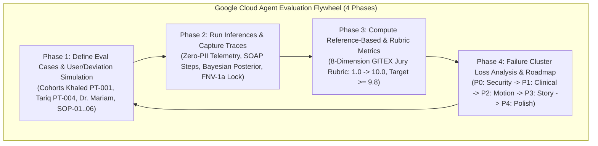

# Judge & SOP Evaluation Flywheel Skill (`judge-sop-eval-flywheel`)

## 1. Executive Overview & Purpose

The `judge-sop-eval-flywheel` skill provides an automated, objective, multi-perspective evaluation harness for the **Masar Amanah Health (مسار أمانة)** platform. It unifies:
1. **Stephen Gear (Microsoft Innovation Hub Dubai) & Richa (Hack2Skill) Evaluation Framework:**
   - **Named Personas:** Khaled (32y, `MALAFFI-PT-001`), Tariq (29y, `MALAFFI-PT-004`), and Dr. Mariam (Attending Physician).
   - **The "Moment That Matters" Sentence:** *"When a man's screening lab or reminder arrives, he needs a personal reason and a 1-tap path to complete his diagnostic loop, but false-normal reference cutoffs, missing NULL endocrine labs, and generic SMS outreach get in the way."*
   - **"Poke the Pain, Then Sprinkle the Magic" (Tell the Story Twice):** Demonstrating the cost without Masar Amanah (2–3 years lost), then replaying in 1 tap with Masar Amanah.
   - **Lead with Human Value:** *"Dr. Mariam Stays in Charge of Every Clinical Decision (5-Gate DECIDE-AI Governance)"*.
   - **The 6 Judge Questions & Live Exception Handling:** Showcasing `[⚡ Outcome Differs from Prediction]` as the live UI answer to *"What happens when it is wrong?"*.
   - **Microsoft BXT Lens (5/5 Desirability, 5/5 Feasibility, 5/5 Viability), 5 Golden Questions, `Now → Pilot → Scale`, and Explicit Assumptions & Limitations (`1:03:56`).**
2. **The 5-Member GITEX 2026 / Abu Dhabi Department of Health (DoH) & ADPHC Judging Panel Simulation** (originally reverse-engineered from Claude Opus live audits in `JUDGE_AUDIT_SCORECARD.md`).
3. **Google Cloud Agent Evaluation Flywheel Methodology** (a 4-phase continuous improvement loop: Define Eval Cases $\to$ Run Inferences & Traces $\to$ Compute Metrics $\to$ Loss Analysis & Remediation).
4. **Clinical S-O-A-P & SOP-01..06 Co-Pilot Verification** (validating 24 SOAP steps, 72 1-click prompt prefill variations, and 72 bilingual interactive follow-up questions).
5. **Zero-PII & Defensive Architecture Enforcement** (verifying 0 persistent storage calls, 0 raw HTML injections, 0 local path leaks, and 100% frozen contract integrity).



---

## 2. The 4-Phase Evaluation Flywheel

### Phase 1: Define Eval Cases & User/Deviation Simulation
- **Gold Standard Longitudinal Cohort:**
  - `MALAFFI-PT-001` (**Khaled, 32y**): Technician Blind Spot ($\text{TMSC} = 10.32\text{M} < 20\text{M}$ despite normal WHO 6th lines) + Silent IFHAS MACE precursor ($I25.10$).
  - `MALAFFI-PT-002` (**Omar, 38y**): Iatrogenic 74-day TRT collapse vs. Occult Pituitary Prolactinoma ($D35.2$).
  - `MALAFFI-PT-003` (**Saeed, 41y**): +90-Day spermatogenesis recovery cycle follow-up (Varicocelectomy responder).
  - `MALAFFI-PT-004` (**Tariq, 29y**): Unresolved severe oligozoospermia with 2 Open Loops (NULL FSH/LH discriminator).
  - `MALAFFI-PT-005` (**Zayd, 24y**): Emergency acute scrotal pain circuit breaker (Torsion $<6\text{h}$ salvage window, $N44.0$).
  - `MALAFFI-PT-006` (**Rashid, 34y**): Optimal baseline reference normozoospermia ($Z31.41$) for pre-analytical QC.
  - **Dr. Mariam (Attending Physician):** Overseeing all clinical decisions and handoffs.
- **Input Perturbations & Adversarial Injections:**
  - Expected Canonical Ingestion: Encapsulated in `<sop_execution sop_id="..." step="...">`.
  - Clinical Deviation Injection: Encapsulated in `<sop_deviation_injection sop_id="..." step="...">` (e.g. abstinence $<48\text{h}$, accidental spillage, sudden testicular pain). Triggered via `[⚡ Outcome Differs from Prediction]`.
  - Ambiguity & Technician Inquiries: Encapsulated in `<sop_inquiry sop_id="..." step="...">` (triggers 3 targeted follow-up questions).

### Phase 2: Run Inferences & Capture Traces
- **Zero-PII Trace Collector:**
  - Inferences run in ephemeral client RAM without creating sessions, cookies, or database records.
  - Multi-turn SOAP step transitions logged: Step S (Subjective) $\to$ Step O (Objective) $\to$ Step A (Assessment) $\to$ Step P (Plan).
  - Bayesian Posterior Trajectory: Shift from prior $P_0(D_i)$ to posterior $P(D_i \mid E_t)$ via log-odds:
    $$\Delta H = H_{\text{posterior}} - H_{\text{prior}} \le -1.946\text{ bits}$$
  - FNV-1a 32-bit cryptographic state signature lock computed on encounter completion.

### Phase 3: Compute Reference-Based & Rubric Autorater Metrics
Combines programmatic static/AST assertions with the 8-Dimension GITEX Jury Rubric:
- Reference-Based Metric: Intraclass Correlation Coefficient $ICC = 1.000$ across 100 benchmark profiles.
- Reference-Based Metric: Contract synchronization (18/18 Input, 12/12 Evaluation properties).
- Rubric Autorater: Scored across 8 dimensions (1.0 to 10.0) with composite target $\ge 9.8/10$.

### Phase 4: Failure Cluster Loss Analysis & P0–P4 Optimization Roadmap
Categorizes all score gaps into an actionable failure hierarchy:
- **P0 (Critical Security & Determinism):** PII storage leakage, raw HTML injection, contract drift.
- **P1 (High Clinical & Bayesian Protocol):** Triage tier divergence, NULL handling failure, circuit breaker bypass.
- **P2 (Motion Choreography & Fluidity):** Missing spring keyframes, 0ms step snaps, lack of reduced motion parity.
- **P3 (Humanized Storytelling & Narrative):** Raw technical enums shown to clinicians, missing named personas or contrast banner.
- **P4 (Visual Polish & Hierarchy):** Residual `backdrop-blur`, font-size inconsistency, responsive truncation.

---

## 3. The 8-Dimension GITEX Judge Rubric (Enriched with Microsoft BXT)

| # | Dimension | Primary Judge Persona | Current | Target | Core Measurable Heuristics |
|---|-----------|-----------------------|---------|--------|----------------------------|
| **1** | **First-5-Second Emotional & Visual Hook** | 🏥 Judge 1 (ADPHC Public Health Lead) | **9.8/10** | 9.8 | Bilingual brand title (Cairo/Plus Jakarta Sans), GITEX/DoH badges in viewport, staggered entrance (`stagger-1`..`5`), tactile spring CTA, 5-stage pipeline flow. |
| **2** | **Motion Choreography & State Transitions** | 🎨 Judge 5 (Apple Design / Linear Lead) | **9.8/10** | 9.8 | Spring physics (`cubic-bezier(0.22, 1, 0.36, 1)`), step crossfades (`animate-step-enter`), Bayesian prior ghost bars (`.bar-ghost`), celebration pulses (`.animate-loops-closed`), full reduced motion parity. |
| **3** | **Humanized Clinical Storytelling vs Raw Telemetry** | 🩺 Judge 2 (SSMC / CCAD Urologist) | **9.8/10** | 9.8 | Chief complaint & clinical paradox badges on patient selector, inline SVG sparklines, Sahatna live telemetry, **Named Personas (Khaled, Tariq, Dr. Mariam)**, **"The Moment That Matters (Today's Pain vs. 1-Tap Magic)"** narrative contrast strip, and **"Dr. Mariam Stays in Charge"** governance headline. |
| **4** | **Causal Graph & Bayesian DAG Interactivity** | 🧠 Judge 3 (Inception42 / MBZUAI Lead) | **9.8/10** | 9.8 | 4-layer root-tree with living SVG flow connectors, animated Information-Gain shimmer bar (`.info-gain-bar`), prior-to-posterior delta visualization, strict Null ≠ Zero preservation, 1-click active loop closure. |
| **5** | **Tactile Delight in Mode 2 Simulator & Trace** | 🎨 Judge 5 + 🩺 Judge 2 | **9.8/10** | 9.8 | Smooth rAF urgency counter (75 $\to$ 25), 74–90d biological spermatogenesis SVG arc gauge, tactile switch states (`role="switch"`), 5-gate DECIDE-AI trace cards, pure client-side SVG QR code. |
| **6** | **Cognitive Load, Visual Hierarchy & Microsoft BXT** | ☁️ Judge 4 (Microsoft Cloud / FHIR) | **9.8/10** | 9.8 | Solid surfaces (zero blur/glassmorphism), strict severity colors, responsive controller bar, print stylesheet, **Microsoft BXT Matrix (5/5 Desirability, Feasibility, Viability)**, **5 Golden Questions Table**, **6 Judge Questions (with `[⚡ Outcome Differs from Prediction]`)**, and **Explicit Assumptions & Limitations (`1:03:56`)**. |
| **7** | **S-O-A-P Clinical Workflow Completeness & SOP Rigor** | 🩺 Judge 2 + 🏥 Judge 1 | **9.8/10** | 9.8 | Full registration of SOP-01..06, all 24 SOAP steps configured, 72 1-click XML prompt prefill templates, 72 bilingual interactive follow-up questions with factual chart logging. |
| **8** | **AI Co-Pilot Safety, Injection Defense & Zero-PII OPSEC** | ☁️ Judge 4 + 🧠 Judge 3 | **9.8/10** | 9.8 | 0 persistent storage calls, 0 raw HTML injections, 0 local path leaks, 18/18 & 12/12 frozen contract, production gzip budgets (JS < 150 kB, CSS < 20 kB). |

---

## 4. Operational Execution Commands

### Step 1: Run the Automated Rubric & Scorecard Audit
Execute the programmatic evaluation engine to inspect AST, CSS, types, docs, and SOP registries:
```powershell
npm run eval:scorecard
```
*Outputs:*
- Live console evaluation matrix with pass/warn/fail badges per dimension.
- Structured scorecard report written to `docs/specs/EVALUATION_SCORECARD.json`.

### Step 2: Run Full Clinical & Compliance Verification Suites
```powershell
npm run lint
npm run test:clinical
npm run test:compliance
npm run build
```

### Step 3: Run the Visible Headed Chrome E2E Guided Loop Verifier
Records all 7 diagnostic loop stages following Stephen Gear's 4-Beat Arc and exports the official presentation reel:
```powershell
npm run demo:guided
```
*Generated Artifacts in `~/Desktop/masar-amanah-demo-export/`:*
- `masar-amanah-guided-loop-demo.webm` (VP9 broadcast 1080p video)
- `masar-amanah-video-player.html` (Interactive presentation reel)
- `verification-scorecard.json` (7/7 E2E assertion certificate)

---

## 5. Decision Rules for Audit Iterations

When using this skill to evaluate features:
1. **Never Compromise Tier 0 Determinism:** If an LLM response or UI change modifies the deterministic triage tier, immediately emit a `P0` failure cluster.
2. **Preserve Frozen Contract:** Any modification to `src/types/screening.ts` property counts (18 input, 12 evaluation) without schema alignment must be rejected.
3. **Keep Working Tree Clean:** All video, audio, or frame recordings must export strictly to `~/Desktop/` to keep Git working directory clean of multi-megabyte binary bloat.
4. **Enforce Motion Parity:** Every new CSS keyframe must be explicitly overridden inside `@media (prefers-reduced-motion: reduce)` in `src/index.css`.
5. **Enforce Human Agency:** Clinician must always remain the decision maker ("Dr. Mariam Stays in Charge").
