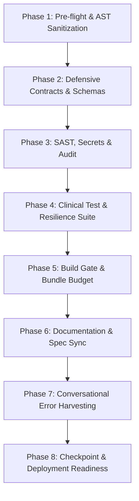

# Master Sync Skill (8-Phase Orchestration Protocol)

This skill is the master top-level orchestrator for synchronizing, validating, and securing the Masar Amanah Health codebase. It migrates the legacy 8-Phase Orchestration workflow (v1.7.0+) into a native Antigravity Skill, following the post-Oct 19, 2026 skill-based governance architecture.

Execute all 8 phases in strict sequential order. Do NOT skip gates.

---

## Phase 1: Pre-Flight & AST/Dead-Code Sanitization
1. **Repository Sanitation**: Scan root and `src/` for orphaned scratch files, temporary logs, or ad-hoc test scripts.
2. **Circular Dependency Verification**: Execute the import cycle detector (`runCircularDepScan()`) to ensure zero circular dependencies across client and server modules.
3. **Dead Code Elimination**: Review exports and unused types. Never delete clinical rules or tests without explicit human confirmation.

## Phase 2: Defensive Contracts & Schema Integrity
1. **Schema vs TypeScript Synchronization**: Run `runContractDriftScan()` to verify that `docs/specs/contract.schema.json` and `docs/specs/response.schema.json` match `src/types/screening.ts` 1:1 with zero drift.
2. **Fail-Fast Input Validation**: Verify that `/api/contextualize` enforces strict JSON schema validation and throws `ValidationError` (HTTP 400) on malformed payloads.

## Phase 3: SAST, Secret Scanning & Dependency Vulnerability Audit
1. **Dependency Audit**: Run `npm audit` and assert zero known vulnerabilities (`found 0 vulnerabilities`).
2. **Static Application Security Testing (SAST)**:
   - Verify zero occurrences of `dangerouslySetInnerHTML` in UI components (must use `SafeNarrative.tsx`).
   - Verify zero hardcoded API keys or credentials in source code.
   - Assert all HTTP security headers (CSP, `nosniff`, `DENY`, `strict-origin-when-cross-origin`) are enforced in `server.ts`.
3. **Zero-PII Storage Leakage**: Run `runZeroPiiScan()` to guarantee zero usage of `localStorage`, `sessionStorage`, `indexedDB`, or `document.cookie`.

## Phase 4: Test Suite & Resilience Verification
1. **Automated Clinical Test Harness**: Run `npm run test:clinical`.
2. **Assertion Gate**: All 14/14 clinical test scenarios must pass (100% pass rate):
   - RES-5: Acute Scrotal Pain Torsion Protocol (Tier 1 Emergency).
   - RES-6: Painless Firm Testicular Mass Protocol (Tier 1 Emergency).
   - RES-7: Anabolic Steroids / TRT HPG Axis Suppression (Tier 2 Andrology).
   - RES-8: Multiple Semen Threshold Failures OATS (Tier 2 Andrology).
   - RES-9: Adipose Aromatization BMI >= 30 + Tobacco (Tier 3 Primary Care).
   - RES-10: Normal Baseline Positive Guidance (Tier 4 Lifestyle).
   - RES-13: Multimodal Lab Scanner Fallback (<10ms).
   - RES-14: 90-Day Spermatogenesis Delta Recalculation.
   - RES-15: 100-Profile UCI Benchmark Execution (<50ms).
   - RES-16: HL7 FHIR R4 RiskAssessment Bundle & Schema Conformance.
   - RES-17 & RES-18: Question Chips & Judge Preset Invariants.

## Phase 5: Build Gate & Bundle Performance Budget
1. **TypeScript Typecheck**: Run `npm run lint` (`tsc --noEmit`) to verify 0 type errors.
2. **Production Bundle Compilation**: Run `npm run build` via Vite.
3. **Gzip Performance Budget**: Execute `runBundleBudgetScan()`:
   - Primary JS bundle: `< 150 kB` gzip (target: ~118 kB).
   - Primary CSS bundle: `< 20 kB` gzip (target: ~9.6 kB).

## Phase 6: Documentation & Spec Synchronization
Synchronize all repository documentation and specifications:
- `docs/specs/PRODUCT_SPEC.md` (`PM-n` traceability).
- `docs/specs/DESIGN_SPEC.md` (`UX-n` design system tokens).
- `docs/specs/03_SECURITY.md` (Zero-Auth, RBAC, Secret Hygiene, Network Boundary PII Guards).
- `docs/specs/DECISIONS.md` (ADR-1 through ADR-6).
- `docs/specs/QA_REPORT.md` (Conformance table, compliance scans, GO/NO-GO verdict).
- `README.md` & `HANDOVER_agy.md`.

## Phase 7: Conversational Error Harvesting & Rule Hardening
1. Review the conversation trajectory and test logs for any edge cases, validation failures, or lint issues encountered during development.
2. Formulate explicit regression tests or type guards to prevent recurrence.
3. Harden the test harness (`scripts/testHarness.ts`) with new negative test assertions.

## Phase 8: Safe Checkpoint & Deployment Readiness
1. **Zero-PII OPSEC Sanitization**: Confirm no personal data, machine-specific paths, or API keys leaked into commit diffs or temporary artifacts.
2. **Deployment Port Compliance**: Confirm server listens on port 3000 (`process.env.APP_PORT || 3000`) for Cloud Run reverse proxying on port 8080.
3. **Status Check**: Review `git status` to ensure all modified and created files are clean and tracked.
4. Report final pipeline synchronization verdict to the user.
