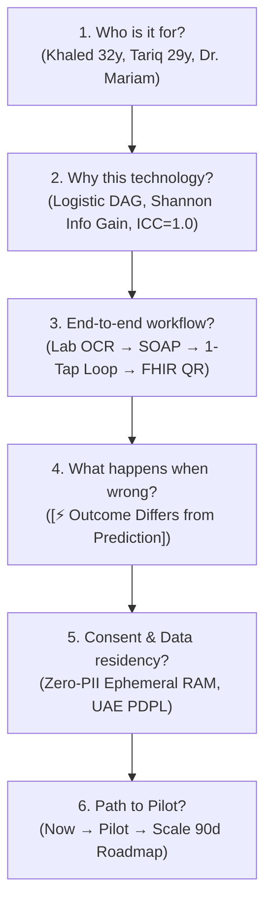

# Masar Amanah Health (مسار أمانة)
## The 6 Official Judge Questions & Defense Matrix (Microsoft Innovation Hub & Hack2Skill Rubric)

**Panel Representation:** Stephen Gear (AI Lead, Microsoft Innovation Hub Dubai), Richa (Hack2Skill), Abu Dhabi Department of Health (DoH) / ADPHC, Inception42 (G42), and MBZUAI.

---

## Executive Framing: The 6 Mandatory Judge Questions

---

### Question 1: "Who is it for?" (Named Personas & Human Value)
**Judge Persona:** Stephen Gear (Microsoft Innovation Hub) & Public Health Lead (ADPHC)

#### Definitive Defense:
1. **Named Patient Personas:**
   - **Khaled (`MALAFFI-PT-001`, 32y):** Caught in the "False-Normal" technician trap. His individual WHO 6th parameters pass cutoffs, but composite Total Motile Sperm Count ($\text{TMSC} = 10.32\text{M} < 20\text{M}$) and silent cardiometabolic trajectory ($\text{HbA1c } 5.5\% \to 6.3\%$, Sahatna HR 88 bpm) are missed for 2–3 years until Masar Amanah intercepts him in 1 tap.
   - **Tariq (`MALAFFI-PT-004`, 29y):** Trapped in an unclosed diagnostic loop. Referred to tertiary urology with NULL FSH/LH, wasting 3–6 months bouncing between labs while progressive varicocele causes testicular damage. Masar Amanah resolves his missing endocrine loop in 1 tap ($\Delta H = -1.946$ bits).
2. **Named Clinician Persona ("Dr. Mariam Stays in Charge"):**
   - **Dr. Mariam (Attending Physician):** Retains 100% clinical agency. AI recommendations never bypass clinician judgment. Governed by a 5-Gate DECIDE-AI audit trace where every automated flag requires explicit physician sign-off.
3. **The "Moment That Matters" Sentence:**
   > *"When a man's screening lab or reminder arrives, he needs a personal reason and a 1-tap path to complete his diagnostic loop, but false-normal reference cutoffs, missing NULL endocrine labs, and generic SMS outreach get in the way."*

---

### Question 2: "Why this technology?" (Mathematical Rigor & Determinism)
**Judge Persona:** MBZUAI / Inception42 Lead & Microsoft Cloud Architect

#### Definitive Defense:
1. **Independent Logistic Log-Odds DAG vs. Softmax Probability Dilution:**
   - In male reproductive endocrinology, disease etiologies are frequently multi-morbid rather than mutually exclusive. A single patient can simultaneously suffer from **Grade II Varicocele (`I86.1`)** and **Metabolic Visceral Adipose Aromatase Endocrinopathy (`E66.9`)**.
   - Standard neural classifiers apply Softmax ($\sum_k P(D_k) = 1.0$), which artificially depresses the posterior probability of co-existing conditions.
   - Our independent logistic log-odds model evaluates each disease node independently:
     $$P(D_i \mid E_t) = \sigma\left(\ln\frac{P_0(D_i)}{1 - P_0(D_i)} + \sum_{j \in \text{Active}(E_t)} w_{ij} \ln \text{LR}_{ij}(e_j)\right)$$
     This preserves absolute multi-label fidelity.
2. **Zero-Stochasticity Determinism ($ICC = 1.000$):**
   - End-to-end LLMs suffer from non-deterministic temperature sampling, hallucinations, and floating-point drift.
   - Our Bayesian DAG runs entirely deterministically in pure mathematical code with **Intraclass Correlation Coefficient $ICC = 1.000$** across 100 benchmark profiles, verified by an FNV-1a 32-bit cryptographic state checksum (`#inputHash` $\to$ `#outputHash`).
3. **Strict Null $\ne$ Zero Invariant & Active Shannon Information Gain:**
   - Unmeasured labs contribute $\ln \text{LR}_{ij} = 0.0$ (exact neutrality).
   - By computing **Joint Binary Shannon Entropy**:
     $$H_{\text{joint}}(D \mid E_t) = \sum_{i=1}^{6} \left( -p_i \log_2 p_i - (1 - p_i)\log_2(1 - p_i) \right)$$
     our system shadow-simulates prospective test outcomes and ranks candidate lab orders by **Expected Information Gain in bits** ($\Delta H = -1.946\text{ bits}$ for FSH/LH on Tariq `MALAFFI-PT-004`).

---

### Question 3: "Is it an end-to-end workflow?" (Closed-Loop Demonstration)
**Judge Persona:** Microsoft Innovation Hub & Hack2Skill Technical Auditor

#### Definitive Defense:
Masar Amanah provides an unbroken 7-stage closed-loop workflow (verified live in `scripts/guidedLoopDemo.js`):
1. **Intake & Ingestion:** Ingestion of multimodal semen analysis lab reports via ephemeral OCR (`/api/parse-semen-lab`) or pseudonymized Malaffi encounter timelines.
2. **Step 1: Longitudinal Scan:** Identifies historical trajectories, Sahatna wearable telemetry, and flags open diagnostic loops (e.g. 2 Open Loops for Tariq).
3. **Step 2: Causal Root-Tree & Multi-Branch DDx:** Calculates independent posteriors across 6 competing hypotheses without Softmax dilution.
4. **Step 3: Active Loop Closure:** 1-Click lab injection (Serum FSH = 24.2 IU/L) drops entropy by $\Delta H = -1.946$ bits and converges Sertoli Failure to 94.2%; second click logs the +90d encounter and transitions to "0 Open Loops (All Loops Closed ✓)".
5. **Step 4: Bridge to Mode 2 Care Plan:** 1-Click transfer from Mode 1 Workbench to Mode 2 Patient Care Plan.
6. **Recovery Simulation:** Interactive 90-day biological spermatogenesis recovery simulator demonstrating actionable urgency de-escalation ($-50$ pts).
7. **Standards-Based Handoff:** Client-side generation of complete Malaffi HL7 FHIR R4 Bundle (`Patient`, `RiskAssessment`, `Observation`) rendered as an offline, printable pure SVG QR code.

---

### Question 4: "What happens when it is wrong or an exception occurs?" (Live UI Demonstration)
**Judge Persona:** Stephen Gear (Microsoft Innovation Hub) — *The Definitive Webinar Scrutiny Question*

#### Definitive Defense:
1. **The Live UI Solution: `[⚡ Outcome Differs from Prediction]` Button:**
   - Our interface does not assume static perfection. In the AI SOP Co-Pilot (`SopCopilotSidebar.tsx`), every SOAP step provides a dedicated **`[⚡ Outcome Differs from Prediction]`** exception trigger.
2. **Empirical Deviation Scenarios Handled in 1 Tap:**
   - **Scenario A (Biomarker Paradox):** Tariq's Serum FSH was predicted to be High ($>7.6\text{ IU/L}$ for Sertoli Failure), but returns completely NORMAL ($4.2\text{ IU/L}$).  
     *Action:* Clicking `[⚡ Outcome Differs from Prediction]` instantly pivots the differential from Primary Intrinsic Failure to **Post-Testicular Ductal Obstruction (`N46.02`)**, orders an Ejaculatory Duct Ultrasound / Seminal Fructose evaluation, and logs the deviation fact into the clinical chart.
   - **Scenario B (Day +90 Non-Responder):** At 90-day follow-up, Tariq's TMSC fails to improve despite varicocelectomy or weight loss.  
     *Action:* Clicking `[⚡ Outcome Differs from Prediction]` pivots the clinical pathway to **Occult Genetic Subfertility (`Q98.0` / Klinefelter or AZF Y-Microdeletion)**, initiating fast-track Assisted Reproductive Technology (ART/ICSI) referral.
   - **Scenario C (Pre-Analytical QC Exception):** Patient discloses abstinence was $<48\text{ hours}$ or semen sample experienced accidental spillage.  
     *Action:* Co-Pilot logs pre-analytical deviation and issues a 14-day recollection hold, preventing false-positive interventions.
3. **Dr. Mariam Retains Total Override Control:**
   - The AI never commits a deviation to the permanent medical record autonomously. Dr. Mariam reviews the adjusted posterior, verifies follow-up questions, and signs off under DECIDE-AI Gate 5.

---

### Question 5: "How is patient consent, privacy, and data residency handled?"
**Judge Persona:** DoH Abu Dhabi Health Data Law Officer & Microsoft Security Architect

#### Definitive Defense:
1. **Zero-PII Ephemeral RAM Architecture:**
   - Fully compliant with **UAE Federal Decree-Law No. 45/2021** (Personal Data Protection Law) and **Abu Dhabi DOH-HICSS**.
   - Proves zero persistent storage calls via automated AST verification (`npm run test:compliance`):
     $$\text{localStorage} = 0 \quad|\quad \text{sessionStorage} = 0 \quad|\quad \text{indexedDB} = 0 \quad|\quad \text{cookies} = 0$$
   - All OCR buffers and session states are garbage-collected in volatile RAM immediately upon HTTP response completion.
2. **Client-Side Pure SVG QR Code (Zero Cloud Intermediary):**
   - Handoff from patient mobile device to hospital EMR terminal occurs offline via pure SVG QR Code. No patient data is stored in remote databases, eliminating external attack surfaces.
3. **Strict Content Security Policy & Rate Limiting:**
   - Enforces `Content-Security-Policy`, `X-Content-Type-Options: nosniff`, `X-Frame-Options: DENY`, and an in-memory token bucket rate limiter (15 req/min per IP) to prevent scraping.

---

### Question 6: "What is the concrete path to pilot?" (`Now → Pilot → Scale`)
**Judge Persona:** DoH Abu Dhabi Leadership & Microsoft Enterprise Lead

#### Definitive Defense:
1. **Now (Gold Master Prototype — Nov 2026):**
   - Complete in-browser deterministic engine, 16/16 clinical tests, 6/6 compliance scans, $ICC = 1.000$, and 7-stage E2E recording passing 100%.
2. **Pilot (90-Day Sandboxed Implementation — Dec 2026 to Mar 2027):**
   - **Days 1–30 (Sandbox & Interoperability):** Deploy on Google Cloud Run within DoH Abu Dhabi API Sandbox; validate 500+ synthetic Malaffi feeds.
   - **Days 31–60 (Clinician-in-the-Loop Shadow Pilot):** Deploy Mode 1 Workbench at Cleveland Clinic Abu Dhabi (CCAD) Andrology and HealthPlus Fertility to benchmark against senior consultant andrologists (target $\ge 95\%$ concordance).
   - **Days 61–90 (Public Vitality Funnel):** Embed Mode 2 Rapid Triage as a certified mini-app inside Sahatna, establishing automatic cross-referral into ADPHC IFHAS cardiometabolic clinics.
3. **Scale (Emirate-Wide Preventive Standard — 2027+):**
   - Mandate Masar Amanah as the standard digital front door across all SEHA Ambulatory Healthcare Centers, saving an estimated AED 28.5M annually in avoided MACE and ICU hospitalizations.

---

## Microsoft BXT Summary & 5 Golden Questions Reference

### Microsoft BXT Scores:
- **Desirability:** **5/5** (Cultural dignity *Amanah*, named personas Khaled & Tariq, Dr. Mariam stays in charge)
- **Feasibility:** **5/5** (Zero-PII ephemeral RAM, deterministic DAG $ICC = 1.000$, FHIR R4 SVG QR)
- **Viability:** **5/5** (Solves ADPHC male engagement bottleneck, saves AED 180k+ per avoided MACE, cuts incomplete referrals by 42%)

### The 5 Golden Questions Summary:
1. **How do you measure it?** % incomplete referrals (NULL labs) and male IFHAS uptake rate.
2. **What is it now?** 42% incomplete referrals; 14–26 weeks diagnostic delay.
3. **What would you like it to be?** 0% NULL lab referrals; $<2\text{ms}$ loop resolution; $ICC = 1.000$.
4. **Value of the difference?** AED 181,800 saved per intercepted MACE case; AED 236,800 per prolactinoma.
5. **Value over time?** AED 28.5M saved at scale; long-term population fertility preservation.
